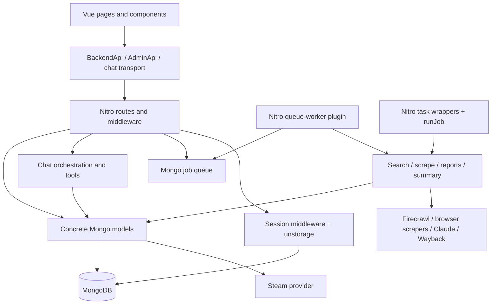
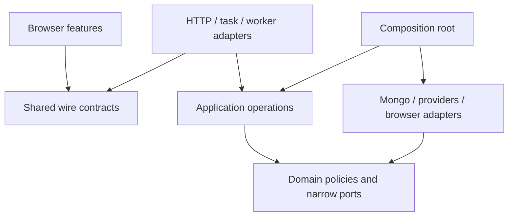

# DeckuDB architecture review

Reviewed on 2026-09-19, against commit `a78b21a`.

## Assessment

DeckuDB should remain a **modular monolith**, with clearer boundaries inside the existing repository. Nuxt, Vue, MongoDB, and the existing provider integrations can support that design. The highest-value improvements are reliable job execution, atomic publication of generated data, explicit API contracts, and independently testable application operations.

The current directories suggest layers, but they do not consistently separate responsibilities. HTTP routes implement business policy, repositories call external providers, pipeline functions receive the entire server dependency container, and browser components define their own interpretations of API responses. Changing a provider, processing policy, or response shape consequently touches several unrelated parts of the application.

There are also concrete correctness risks underneath those boundaries: timed-out work continues running, replacement reports are deleted before their successors are validated, model-generated text reaches an HTML sink, and delayed chat writes can recreate deleted sessions. Address these before undertaking a large file move.

### Scope and confidence

The review covers the application and its integration boundaries: `app/`, `server/`, `shared/`, `test/`, configuration, CI, Docker, and operational documentation. The source inventory contains 83 application files, 79 server files, 11 shared files, and 32 test/support files, counting TypeScript, Vue, and CSS. Generated output and assets are not architectural source. The sibling `mbs3` and `webscrapper` repositories are outside scope; relevant installed dependency behavior was inspected where necessary.

Findings below distinguish behavior visible in source from recommended designs. Concurrency failures are reasoned from the implementation unless explicitly marked as reproduced in the validation section. This is not a production load test, penetration test, dependency vulnerability audit, or measurement of current database volume. No production database or provider credentials were used for verification.

Source links identify the reviewed baseline; line numbers will change as the code evolves.

### Validation performed

| Check | Result | Scope |
| --- | --- | --- |
| `npm run lint` | Passed; 213 files checked | Existing repository lint baseline |
| `npm run typecheck` | Passed | Placeholder configuration and disabled Sentry |
| `vitest run --project unit --project api` | Passed; 20 files, 288 tests | Isolated copy of tracked sources, existing provider mocks, temporary MongoDB |
| Session revocation reproduction | Reproduced stale-save recreation of an authenticated session | Actual `saveSession`/`destroySession` functions with independently cloned request sessions and an in-memory storage adapter |

The unit/API run used a temporary source copy with `.env` excluded, a clean environment loaded from `.env.test`, and `nuxt prepare` before execution. The initial sandboxed attempt failed before test collection because Mongo could not bind a local socket; the isolated retry with local socket access passed. Mongo binary downloading was disabled. The extra reproduction was kept outside the repository and was not added to the product's test suite; it proves the session-storage primitive race, not a complete browser/stream exploit.

Browser E2E tests, a production image build/run, live-provider calls, deployment checks, and production load testing were not performed. Passing existing tests does not disprove the uncovered lifecycle and concurrency findings.

## Current architecture



The important runtime flows are:

| Flow | Current ownership | Architectural consequence |
| --- | --- | --- |
| Search and popular games | Browser client → routes → `SteamCacheModel` → Mongo/Steam | Cache persistence and provider policy share one class. |
| Game details | GET route reads game/Steam data, decides freshness, and queues work | A read also triggers potentially expensive processing; readiness is inferred from a game document existing. |
| Processing | Embedded worker or separate Nitro task runner → four pipeline stages | Execution, timeout, retry, and shutdown rules differ between entry points. |
| Admin | Server middleware and route guards, signed server-side session, audit wrapper | Good enforcement exists, but route policy and session lifecycle are spread across several modules. |
| Support chat | Streaming HTTP handler → provider/tools → whole-session save at completion | Conversation writes share a storage record with authentication state. |

### Foundations to preserve

- The browser, API, and worker share one repository and deployment model. That is a manageable topology for this product.
- API request validation already uses Zod, with a common error adapter in `server/utils/api.ts`.
- Mongo access is mostly centralized in model classes. Atomic job claiming and the bounded atomic rate-limit update are useful building blocks.
- Raw captures, normalized reports, and generated summaries are already distinct concepts.
- Admin authentication rotates session identifiers, uses HTTP-only cookies, and checks authorization on the server. Audit context is deliberately restricted.
- The audit-log screen already demonstrates server pagination and request cancellation that other screens can reuse.
- Sentry, redaction helpers, unit/API/browser test projects, and release validation exist. Extend these rather than introduce parallel systems.

## Prioritized improvement backlog

Priority means implementation order: **P1** addresses correctness or trust boundaries; **P2** establishes maintainable boundaries and operational reliability; **P3** is useful follow-up once those foundations exist. Effort is relative: S is localized, M crosses a few modules, L changes a lifecycle or persisted-data contract. These are not calendar estimates.

| ID | Priority | Improvement | Effort |
| --- | --- | --- | --- |
| A01 | P1 | Make job ownership, retries, cancellation, and publication safe | L |
| A02 | P1 | Publish validated report/summary versions atomically | L |
| A03 | P1 | Render generated summaries as untrusted text | S |
| A04 | P1 | Separate conversation writes from session authentication and revocation | M |
| A05 | P2 | Introduce shared wire contracts and explicit response mapping | M |
| A06 | P2 | Extract application operations and narrow dependency interfaces | L, incremental |
| A07 | P2 | Centralize provider validation, errors, deadlines, and concurrency | M |
| A08 | P2 | Model processing status, freshness, and provenance explicitly | M–L |
| A09 | P2 | Consolidate browser query state and resource lifecycles | M |
| A10 | P2 | Use server-side job filtering, pagination, and statistics | M |
| A11 | P2 | Make configuration, startup, health, and process ownership explicit | M |
| A12 | P2 | Establish schema/index migrations, retention, and stable data identity | M |
| A13 | P2 | Test real boundaries and failure paths; separate test environments | M, ongoing |
| A14 | P2 | Add structured operational context and verified releases | M |
| A15 | P3 | Simplify feature organization, UI reuse, and documentation | M, incremental |

### A01 — One execution model with enforceable job ownership

**Evidence.** [`shared/async.ts:24`](../shared/async.ts#L24) implements `withTimeout` with `Promise.race`; the underlying task is not cancelled. [`queue-worker.ts:102`](../server/plugins/queue-worker.ts#L102) then requeues failures. [`jobs.model.ts:155`](../server/models/jobs.model.ts#L155) completes work using only `job_id` and status; failure/requeue operations have the same limitation. The timeout sweep at [line 286](../server/models/jobs.model.ts#L286) does not enforce the maximum attempt count.

Enqueue uses an active-job upsert at [`jobs.model.ts:110`](../server/models/jobs.model.ts#L110), but the indexes at [line 311](../server/models/jobs.model.ts#L311) do not enforce uniqueness of an active logical job. Concurrent requests can create duplicate work. Different job types for the same game can also overlap even if same-type deduplication is fixed.

**Impact.** A timeout can start a new attempt while the old attempt still writes reports or summaries. Around a cross-worker timeout sweep and reclaim, an older executor can update a newer attempt's job status. Repeated crashes can exceed retry limits. These are data-ownership problems, not reasons by themselves to adopt a new queue product.

**Required changes.**

1. Introduce an execution identity: `attempt_id`, `worker_id`, `lease_expires_at`, and a heartbeat. Claim, renew, complete, and fail with conditional updates that match the current attempt.
2. Enforce active-work uniqueness in Mongo, using an explicit active key or suitable unique partial index. Reconcile existing duplicates before creating the constraint. Define whether operations that mutate the same game serialize or publish independent versions.
3. Pass an `AbortSignal` through pipeline stages, fetches, model calls, and browser work. Fence publication by current execution/version ownership as well: cancellation alone cannot prevent every late result. Check ownership atomically with the visible-version switch, using a condition on the publication document or a transaction. Reading a job token and then writing another document is still racy.
4. Add `available_at`, bounded exponential backoff with jitter, a distinction between retryable and permanent failures, and an attempt history. Apply one attempt budget to ordinary failures, expired leases, and crashes.
5. Extract one executor and one pipeline registry. The worker and Nitro task wrappers must invoke them. [`job-runner.ts:19`](../server/utils/job-runner.ts#L19) currently installs process listeners per invocation; its error path permanently fails work instead of applying the worker policy. Own signals and cleanup once at the process entry point.

**Acceptance checks.** Concurrent enqueue has one defined logical outcome; two workers cannot own one attempt; a stale attempt cannot publish or complete another attempt; crash recovery exhausts the same retry budget; shutdown cancels/drains within a defined deadline. Preserve at-least-once execution assumptions and make publication idempotent.

### A02 — Validate first and publish complete data versions

**Evidence.** [`game-reports.model.ts:39`](../server/models/game-reports.model.ts#L39) deletes reports for incoming sources before calling the validation and insert path at [line 25](../server/models/game-reports.model.ts#L25). [`generate-game-reports.ts:58`](../server/tasks/generate-game-reports.ts#L58) saves game metadata before report replacement. Summary generation then reads the current reports and overwrites a single summary field at [`generate-game-summary.ts:24`](../server/tasks/generate-game-summary.ts#L24).

**Impact.** Invalid input, database failure, or process termination can remove the previous good reports. Readers can observe an intermediate dataset. Independently running report and summary jobs can combine results from different runs.

**Required changes.** Validate the entire candidate report set before any destructive write. As an immediate repair, make replacement atomic with a transaction if the deployment supports it. The longer-term model should stage immutable report sets and summary versions, then atomically change a game's active-version pointer after all required work succeeds. A run should reference its exact input captures and report set. Keep the previous successful version available during a refresh and retire old versions asynchronously.

The current Compose definition uses a standalone Mongo service; do not assume multi-document transactions are available without changing that topology. A versioned publication design can keep the final visibility switch to a single document. The switch must still be guarded against stale execution ownership and define whether reports may publish before a summary is ready.

**Acceptance checks.** Invalid reports and failed inserts leave the old dataset readable; publication never exposes a half-replaced set; a retry does not duplicate visible reports; the summary identifies the exact report version it summarizes.

### A03 — Keep model output outside the HTML trust boundary

**Evidence.** [`AskAICard.vue:23`](../app/components/common/AskAICard.vue#L23) renders its text with `v-html`. The game page builds that text from the saved summary and an HTML disclaimer at [`[gameId].vue:119`](../app/pages/game/%5BgameId%5D.vue#L119). [`generate-game-summary.ts:66`](../server/tasks/generate-game-summary.ts#L66) feeds scraped report text into generation; its cleanup removes prefixes and whitespace, not HTML.

**Impact.** Externally sourced/model-generated content reaches an executable HTML sink. Source inspection establishes the unsafe path; this review does not claim a demonstrated exploit against the deployed site.

**Required changes.** Render the summary through Vue text interpolation and render the disclaimer as separate template markup. The product currently requests a few plain-text sentences, so a rich-text renderer is unnecessary. If rich text becomes a requirement, define one sanitized rendering boundary and allowed URL protocols. Keep trusted generation instructions separate from untrusted source content, but do not rely on prompting for output safety.

**Acceptance checks.** HTML-like source/model output displays as text and cannot introduce elements or event handlers; ordinary summaries and the disclaimer remain readable.

### A04 — Separate session identity, revocation, and conversation storage

**Evidence.** [`session.ts:15`](../server/utils/session.ts#L15) puts admin authentication and support-chat messages in one session object. [`chat.post.ts:143`](../server/api/chat.post.ts#L143) writes that request's session snapshot when a stream completes. [`session.ts:116`](../server/utils/session.ts#L116) saves the whole object with `setItem`, while logout deletes it at [line 145](../server/utils/session.ts#L145). The installed unstorage Mongo driver implements `setItem` as an upsert.

**Impact.** Two overlapping chat requests can overwrite each other's conversation changes. More seriously, a chat begun with an authenticated session can finish after logout and recreate the old authenticated record. Deleting the browser cookie does not make the old signed identifier invalid if its server record is recreated. A public tab and an admin tab can share the same cookie.

The isolated reproduction confirmed the underlying sequence: clone an authenticated request session, delete it through `destroySession`, then persist the stale clone through `saveSession`; the stored record is authenticated again. The actual Mongo driver's upsert behavior is consistent with this reproduction.

Session allocation is also too broad: [`middleware/session.ts:57`](../server/middleware/session.ts#L57) creates sessions for almost every API request, including health checks, catalog reads, and telemetry. The current storage mount has no application-managed session indexes or TTL, and expiry is a numeric field checked/deleted only when that session is read again. The Docker health probe does not retain cookies, so repeated probes can create abandoned records.

**Required changes.** Introduce a session repository with unique identity, a real expiration date/index, conditional updates, and explicit revocation semantics. Updating a conversation must never upsert authentication state. Store conversations separately, with a version or ordered append policy and a defined rule for concurrent turns. Allocate anonymous identity only for features that require it, such as voting and chat. Keep health, telemetry, and public catalog reads session-free.

**Acceptance checks.** Completing a stream after logout cannot recreate an authenticated session; overlapping turns have defined ordering/conflict behavior; expiry cleanup removes abandoned sessions; health and catalog requests do not allocate session records.

### A05 — Own the browser/API contract in one framework-neutral place

**Evidence.** [`BackendApi.ts:51`](../app/plugins/api/BackendApi.ts#L51) defaults requests to `unknown`; public methods do not supply response types. Consumers cast their own shapes from [`components/ui/types.ts`](../app/components/ui/types.ts). Admin types are separately defined in [`plugins/api/types.ts`](../app/plugins/api/types.ts), while server responses are exported from route files and often reuse persistence types, for example [`games/[id].get.ts:14`](../server/api/games/%5Bid%5D.get.ts#L14). Those models contain `Date` values, whereas JSON carries strings. Several repository responses also expose unprojected Mongo documents.

**Impact.** TypeScript does not establish agreement between the two sides. Broad optional fields, `Partial<Game>`, casts, and index signatures conceal missing data and make persistence changes leak into the API.

**Required changes.** Create `shared/contracts/` for request/response schemas and inferred DTO types. It should contain no Mongo, Nitro, Vue, SDK, or environment dependencies. Model dates as ISO strings on the wire and map database/domain objects explicitly at the server boundary. Return a deliberate public Steam/game projection instead of the provider's entire shape. Define typed client methods, typed vote/job enums, and a common error envelope with stable error codes. Runtime-validate untrusted provider input and selected API boundaries; do not repeatedly validate already trusted internal values at every layer.

Use a discriminated response for processing state rather than optional fields that happen to be present. Keep browser view models separate only when they genuinely transform the DTO for presentation.

**Acceptance checks.** Changing a required response field breaks the relevant server/client contract checks; browser pages no longer assert unknown responses into local DTOs; serialized dates and allowed public fields are tested; persistence-only fields do not escape by accident.

### A06 — Extract application operations and narrow dependencies

**Evidence.** [`bootstrap.ts:14`](../server/utils/bootstrap.ts#L14) exposes every concrete repository and the raw database client as `ServerDependencies`. Pipeline functions receive this whole container. `SteamCacheModel` both persists cache entries and calls Steam at [`steam-cache.model.ts:48`](../server/models/steam-cache.model.ts#L48). Tasks construct providers or call global wrappers directly. Models import their `Repository` interface from the bootstrap module that constructs them.

**Impact.** Infrastructure and composition details become dependencies of business operations. Isolated tests require Nuxt configuration and module mocks; simple changes have an unnecessarily large dependency surface.

**Required changes.** Extract named application operations such as `GetGameDetails`, `EnsureGameRefresh`, `QueueProcessing`, `GenerateReports`, `GenerateSummary`, and `SendSupportMessage`. Inject only their required capabilities: a catalog, relevant repositories, provider interfaces, clock, logger, and execution context. Use plain functions or small classes with constructor arguments; a dependency-injection framework is unnecessary.

Move cache policy into a `CachedGameCatalog` service composed from a Steam adapter and a cache repository. Keep pure parsing/domain policy independent of transport. Nitro handlers should validate input, enforce access, call an operation, and map its result. The composition root constructs and owns concrete resources; it should not define interfaces imported by those resources.

**Acceptance checks.** Core policies and stages can run in Node with in-memory fakes and no Nuxt runtime, Mongo process, or module mocking. Adding a source mainly adds a capture/parser adapter and its fixtures. Routes and workers use the same operations.

### A07 — Make provider behavior predictable and bounded

**Evidence.** [`steam.ts:12`](../server/services/steam/steam.ts#L12) and [`FirecrawlService.ts:39`](../server/services/firecrawl/FirecrawlService.ts#L39) trust JSON shapes through casts. The cache maps all detail-fetch failures to not-found at [`steam-cache.model.ts:67`](../server/models/steam-cache.model.ts#L67). Batch fetching uses unbounded `Promise.all` at [line 83](../server/models/steam-cache.model.ts#L83), and the batch route does not cap the ID count. The search term has no maximum length. Firecrawl, Steam, Wayback enrichment, and the telemetry tunnel do not share a request deadline/cancellation policy.

Browser resource ownership is similarly implicit: [`Miner.ts:20`](../server/utils/data-mining/Miner.ts#L20) declares `close(): void`, but the underlying scraper closes asynchronously. Implementations discard that promise, and report parsing constructs browser-backed miners just to call `polish` at [`generate-game-reports.ts:86`](../server/tasks/generate-game-reports.ts#L86).

**Required changes.**

- Validate provider responses and normalize provider errors into not-found, throttled, unavailable, invalid-response, and cancelled outcomes. Preserve causes for diagnostics; return 404 only for actual absence.
- Pass deadlines and cancellation through adapters. Bound batch sizes, input lengths, outbound concurrency, and retries. Give optional Wayback enrichment a warning/fallback policy so it cannot unnecessarily fail an otherwise valid report set.
- Split pure parsers from browser capture adapters. Await asynchronous disposal in `finally` and make resource ownership visible in interfaces.
- Use unique cache keys, a fixed key for the popular-games singleton, and request coalescing for concurrent misses. Return batch items in requested order and define partial-failure behavior.
- Define provider-cost controls for public operations. Anonymous-session chat quotas can be reset by obtaining a new session, and a public game read can enqueue paid processing. Keep those product capabilities if desired, but add an aggregate budget/concurrency limit and an explicit admission policy. A UI visibility flag alone is not a server capability switch.

**Acceptance checks.** Malformed/429/5xx responses are distinguished from missing games; a cancelled operation stops acquiring resources and cannot publish; large batches are bounded; repeated cache misses do not fan out without limit; browser cleanup is awaited on success and failure.

### A08 — Represent freshness, progress, and generated-data lineage

**Evidence.** [`games/[id].get.ts:34`](../server/api/games/%5Bid%5D.get.ts#L34) sets `queued` before knowing whether enqueue succeeds, while `queueGameScrape` logs and suppresses unexpected enqueue errors at [line 59](../server/api/games/%5Bid%5D.get.ts#L59). Any existing game is returned as `ready`. Freshness uses the most recent non-failed job's `updated_at`, rather than the last successfully published data. Game metadata is saved before reports and summary finish. [`games.model.ts:19`](../server/models/games.model.ts#L19) updates a generic generation timestamp for all game saves.

Compatibility refresh also conflates absence of a response with a negative result: [`generate-game-reports.ts:58`](../server/tasks/generate-game-reports.ts#L58) writes `steamdeck_verified: false` when the provider status is unavailable. Summaries carry no model/prompt/input version, and votes are keyed by game/session rather than summary version in [`game-summary-votes.model.ts:21`](../server/models/game-summary-votes.model.ts#L21).

Partial refresh results are represented mostly as warning strings. [`scrape-game.ts:57`](../server/tasks/scrape-game.ts#L57) catches capture failures and skips missing captures, then returns warnings even if every capture fails. If old captures exist, report generation can read them and the full pipeline can republish old information under a successful new job. A successful attempt is therefore not necessarily proof of newly observed source data.

**Required changes.** Separate data availability from refresh progress. A response should be able to say “published data available, refreshing” or “no data, refresh failed,” with a bounded retry/polling hint. Store successful publication time separately from attempts, failures, and individual provider observation times. Return an explicit failure if scheduling fails; do not claim work is queued when it is not.

Make the refresh operation explicit and idempotent. Prefer a read-only game query plus an intentional refresh command; if automatic refresh on reads remains a product choice, encapsulate it as a documented application policy with admission limits and cache implications.

Record run/capture/report-set/summary identifiers, parser version, summary model and prompt version, and an input hash. Bound eligible summary input by recency, diversity, and token budget; output token limits do not bound the input. Handle “no eligible reports” explicitly. Preserve last-known compatibility on temporary retrieval failure. Decide whether votes refer to a particular summary or a game-wide score and encode that choice in the key.

Return structured stage/per-source outcomes, including capture success, newly observed content, reused content, and errors. Set explicit freshness and partial-publication criteria instead of inferring them from an empty warning list or a completed job.

**Acceptance checks.** The browser can distinguish queued, running, failed, and successfully published outcomes; an existing game document cannot falsely prove pipeline completion; unchanged input can reuse a summary; provider failure preserves prior facts with their observation dates.

### A09 — Give browser queries and side effects a single owner

**Evidence.** Public data loading is repeated across the game page, search page, `GameSearch`, and `PopularGames`. The game fetch/watch flow at [`[gameId].vue:158`](../app/pages/game/%5BgameId%5D.vue#L158) and search fetch at [`search.vue:69`](../app/pages/search.vue#L69) have no consistent cancellation or stale-response protection. [`GameSearch.vue:155`](../app/components/ui/GameSearch.vue#L155) has another request lifecycle. In contrast, the admin audit-log page handles cancellation and stale requests.

[`utils/performance.ts:112`](../app/utils/performance.ts#L112) initializes monitoring on import, and [`performance.client.ts:4`](../app/plugins/performance.client.ts#L4) initializes it again. This is a concrete instance of side-effect ownership being split.

**Required changes.** Introduce feature composables such as `useGameDetails`, `useGameSearch`, `usePopularGames`, and `useJobsQuery`. They should own request keys, cancellation, stale-result guards, errors, polling, and disposal. Propagate signals through the typed clients. Reset route-scoped state when the game/query changes, prevent overlapping polls, and stop polling after terminal states or unmount.

Distinguish four forms of state: server query state, URL/filter state, durable browser preferences/recent games, and local interaction state. Keep them in the appropriate owner instead of promoting everything to a global store. Existing Nuxt/Vue primitives are sufficient initially; introduce a query library only if these requirements exceed a small set of consistent composables.

The search page currently changes `route.query.q` while typing but does not observe query changes as the single fetch trigger at [`search.vue:109`](../app/pages/search.vue#L109). Separate draft text from the committed URL query: submit by navigating, fetch by watching the committed query, and let back/forward navigation restore matching results.

Mutation feedback belongs to the operation owner too. [`RefreshButton.vue:55`](../app/components/common/RefreshButton.vue#L55) reloads the whole document despite declaring a refresh event. Make it emit an action that the feature composable handles. [`AskAICard.vue:140`](../app/components/common/AskAICard.vue#L140) thanks the user before the vote request succeeds, while the page only logs a failed vote. Represent pending, success, and failure explicitly and confirm success after the API response.

Make browser utilities side-effect-free at import. Plugins install monitoring once and retain cleanup handles; browser-only storage/listeners belong in client lifecycle hooks.

Check asynchronous setup as well as synchronous disposal: `PopularGames` adds a resize listener after awaiting its fetch, and `GameVideoPreview` probes media before creating HLS resources. Both need an active-request/lifecycle check so a completed request cannot allocate resources after unmount. The current SPA mode means possible future SSR issues should not be described as existing cross-request data leaks.

**Acceptance checks.** A slow response for game/query A cannot overwrite B; polling stops on navigation and terminal failure, with bounded retries for transient failures; page remounts do not accumulate observers/listeners; key request-state behavior is covered with controllable delayed promises.

### A10 — Let the server paginate and aggregate jobs

**Evidence.** [`AdminApi.ts:63`](../app/plugins/api/AdminApi.ts#L63) follows every jobs page and merges all records. The admin screen then filters, counts, and paginates locally. [`jobs/index.get.ts:9`](../server/api/jobs/index.get.ts#L9) already accepts several server filters, but the browser's page-fetch method does not expose them.

**Impact.** Each dashboard refresh scales with total job history instead of visible results. Mutable offset pagination can also yield inconsistent page collections while jobs are inserted or changed.

**Required changes.** Expose `fetchJobs(query, signal)` returning one page. Apply filters, sorting, and pagination on the server; add a small aggregate statistics query with clearly defined filter scope. Use stable sort tie-breakers such as `created_at` plus `job_id` and indexes for observed query patterns. Start with offset pagination; use cursors if volume and update frequency justify them. Reuse the audit-log screen's query pattern.

**Acceptance checks.** Loading a page makes a bounded number of requests independent of history size; counts agree with their documented filters; paging stays deterministic for equal timestamps.

### A11 — Make startup, configuration, health, and process lifetime explicit

**Evidence.** [`config/index.ts:12`](../server/config/index.ts#L12) reparses the entire runtime configuration on access. Jobs and the worker read configuration at module scope. [`config.schema.ts`](../server/config/config.schema.ts) requires Claude, Firecrawl, and admin credentials even for process roles that might not use those capabilities. [`bootstrap.ts:13`](../server/plugins/bootstrap.ts#L13) catches initialization failure and retains an unusable settled dependency promise, then every request hook awaits it. [`health.get.ts`](../server/api/health.get.ts) returns a static response behind the same infrastructure/session middleware.

The HTTP bootstrap, worker bootstrap, and unstorage driver each own a Mongo client. This is not inherently incorrect, but connection counts and shutdown behavior are not centrally described. The worker's abort signal interrupts polling, not the currently running pipeline.

**Required changes.** Validate configuration once per process composition root and inject feature-specific values. Preserve deployment-time overrides; keep the small early Sentry configuration reader explicit where preload order requires it. Use public framework entry points instead of `nitropack/runtime/internal/storage` imports.

Choose explicit startup behavior: fail the process on unrecoverable initialization errors, or expose a managed degraded/readiness state with bounded reconnect behavior. Separate liveness from readiness, exempt both from session creation, and make readiness report required dependency state. Track worker health independently so a web process cannot silently appear operational while its worker has stopped.

After the executor is corrected, add explicit `web`, `worker`, and optionally combined development process roles in the same repository/image family. A separate worker process is useful when scraping load or deployments affect web latency; it does not require a separate service repository. Own Mongo/browser resources and graceful shutdown at those entry points. Keep one documented install/preparation path despite disabled npm lifecycle scripts, and verify the container browser version matches the scraper's resolved Playwright version.

**Acceptance checks.** Disabled capabilities do not require unrelated credentials; an initial dependency failure has a deliberate recovery/exit path; liveness does not write to Mongo; readiness reflects dependency state; shutdown does not leave browser tasks writing after ownership is released.

### A12 — Treat persisted data and indexes as versioned contracts

**Evidence.** Index creation runs on application startup; audit retention even adjusts an index with `collMod` at [`audit-logs.model.ts:113`](../server/models/audit-logs.model.ts#L113). There is no versioned migration runner. Jobs and Steam cache logical uniqueness are not fully enforced. [`scrapes.model.ts:25`](../server/models/scrapes.model.ts#L25) hashes the whole raw scrape, including volatile metadata: the fallback capture includes a new timestamp at [`scrape-game.ts:48`](../server/tasks/scrape-game.ts#L48), as does the installed scraper. Raw scrape history has no retention policy in its indexes.

**Required changes.** Add explicit, repeatable database migrations with version tracking and preflight checks. Startup can verify compatible schema/index versions; it should not be the only mechanism for coordinating data/index changes across replicas. Document migrations that deduplicate active jobs/cache keys, introduce date-based session expiry, and add publication versions. Test migration of populated databases, not only empty collection creation.

Canonicalize material content before hashing: separate content identity from capture time, update `last_seen_at` for unchanged captures, and define raw-capture/job/version retention. Source discovery should update metadata and represent retirement instead of only inserting missing sources. Avoid treating substring domain matches as a durable source identity rule.

Move `insertTest*` methods and `DatabaseClient.flushDB()` into test support. They should not be part of the production repository contract. Keep raw Mongo handles inside infrastructure except for a deliberate migration/maintenance entry point.

**Acceptance checks.** Capturing unchanged content twice produces one content identity; duplicate cleanup precedes unique-index installation; old populated data migrates predictably; abandoned sessions and obsolete captures have an enforceable retention policy.

### A13 — Align tests with architectural boundaries and real runtime behavior

**Evidence.** [`vitest.config.mts:15`](../vitest.config.mts#L15) places Mongo global setup at the root, so even unit-only selections start a database. [`test-server.ts`](../test/integration/api/test-server.ts) builds a manual H3 route/middleware stack; [`server.setup.ts`](../test/server.setup.ts) substitutes an in-memory session store and mocks integrations. These tests are useful for handlers but cannot prove production plugin wiring or the actual Mongo session-storage contract. Existing tests cover endpoint behavior and parsers/providers, but there is no direct executor/pipeline suite for the ownership and publication failures described above.

Most API fixtures call `bootstrapDependencies` without `createDBIndexes`; for example, [`jobs.test.ts:36`](../test/integration/api/endpoints/jobs.test.ts#L36). The rate-limit suite separately initializes its own indexes. Consequently, the green API suite does not exercise the production collection/index setup as a whole, and the duplicate-job test at [line 261](../test/integration/api/endpoints/jobs.test.ts#L261) is sequential rather than concurrent. Introduce a shared integration fixture that runs the production schema/index initializer against each isolated database, plus a contract suite for the real Mongo session adapter.

**Required changes.** Keep four deliberately different test layers:

| Layer | Dependencies | What it should prove |
| --- | --- | --- |
| Pure policy/use-case tests | Fakes, controllable clock, no database/Nuxt | Retry decisions, processing states, summary selection, parsers, cancellation policy |
| Repository/adapter integration | Isolated real Mongo or local provider stub | Atomic claims, uniqueness, conditional updates, publication, migrations, session expiry/revocation |
| Actual Nitro integration | Boot production composition with test adapters | Plugin ordering, middleware, routes, readiness, storage wiring, streaming lifecycle |
| Browser journeys | Small set of deterministic fixtures | Search → game → processing outcome; admin actions; chat UX; navigation races |

Move database setup into projects that require it. Replace broad module mocks with injected ports over time. Keep the manual H3 harness for focused handler tests, but do not use it as evidence that production startup and middleware registration work. Fail tests on unexpected outbound network requests; install browser interception before navigation and inject provider stubs for server-side calls. Use unique database names and isolated test configuration.

Add failure tests alongside A01–A04, then wire-contract, stale-response, provider-error, and migration tests. Measure coverage for those critical paths rather than pursuing a blanket percentage or tests that merely restate implementation details.

The frontend also lacks a component/composable test layer between API-client units and browser journeys. Add focused tests for the extracted query state, delayed responses, unmount/disposal, URL synchronization, failed mutations, and summary rendering; retain browser tests for complete flows and keyboard interactions.

**Acceptance checks.** Unit tests work offline without Mongo/Chromium; actual Nitro startup is tested; the real session persistence semantics are covered; network mistakes fail locally instead of consuming credentials; critical concurrency regressions have deterministic tests.

### A14 — Preserve structured context through operations and releases

**Evidence.** [`logger.ts:109`](../server/utils/logger.ts#L109) formats arbitrary arguments into an unlimited string, discarding structure before transport. File/console formatting is separate from Sentry's redaction hooks. Job status holds an overwritten message rather than structured attempt/stage history. The Docker CI job builds but does not run the image, and [`publish-and-deploy.yml`](../.github/workflows/publish-and-deploy.yml) ends deployment verification at a successful webhook request.

**Required changes.** Emit structured events with operation, request/run/job/attempt IDs, game ID, stage, elapsed time, outcome, provider, and retry classification. Redact at the shared logging boundary before any transport; keep audit identity handling an explicit restricted policy. Avoid dumping complete reports/prompts/provider objects by default. Give each failure one clear exception-capture owner to limit duplicate telemetry.

Track queue age, failed/exhausted work, lease expiry, stage/provider latency, browser cleanup failures, cache hit rates, and generation cost. Start with the existing logging/Sentry setup and add only the metrics needed to detect a stuck or expensive pipeline. Keep audit persistence failure observable; if the product ever requires guaranteed audit durability, make that a separate explicit requirement rather than assuming the current best-effort wrapper provides it.

In CI, run the built production image with isolated fixtures and verify startup/readiness plus one API operation. After deployment, verify the deployed version and readiness rather than only the webhook response. Prefer promotion of a known image digest and document rollback and migration compatibility. Repository code cannot establish the cloud provider's current rollout/backup behavior; confirm those operational details separately.

**Acceptance checks.** A user-visible processing failure can be traced to its attempt and provider without inspecting raw payloads; telemetry is redacted consistently; release validation exercises the artifact that will run; successful deployment means a verified running version.

### A15 — Organize by feature after responsibilities are clear

Generic names such as `utils`, `common`, and `ui` currently contain both reusable primitives and product-specific behavior. Large Vue files also repeat table/filter/dialog styling. Size alone is not a reason to split them: extract components or composables around stable responsibilities and shared behavior.

Move game, catalog, jobs, audit, and support-chat code toward feature ownership while keeping Nuxt route/layout/plugin conventions. Keep design primitives domain-free; add only the shared form, dialog, table, and status primitives that have demonstrated reuse. Centralize repeated visual tokens and use scoped styles for feature details. Avoid introducing a general schema-driven UI system.

Reusable controls should also own interaction invariants. [`GameReport.vue:2`](../app/components/ui/GameReport.vue#L2) uses nested clickable elements without consistent keyboard/link behavior; profile activation can also trigger the report destination. Prefer semantic links, scoped combobox keyboard handling, and shared visible focus styles; [`Button.vue:75`](../app/components/base/Button.vue#L75) currently removes the focus outline. Verify one intended destination per activation and keyboard-only access. Keep the chat transport's API base consistent with the injected clients rather than hard-coding another endpoint owner.

Document the dependency rules, processing state machine, API DTO conventions, process roles, and migration procedure. Record a few architecture decisions rather than a large process manual. Reconcile `todo.md` with implemented Sentry, existing documentation, and this prioritized backlog. Keep SSR/SEO as a separate product decision: isolate browser-only initialization before introducing SSR; establish session-free public queries and controlled write effects before shared caching. Add route-specific canonical/social metadata if indexable game pages are a requirement. Enabling SSR across the application now would add lifecycle work without resolving the existing boundaries.

## Proposed structure and dependency rules

The following is a direction for incremental refactoring, not a requirement to move every file immediately:

```text
app/
  pages/                       Nuxt route adapters and screen composition
  layouts/                     Public and admin shells
  plugins/                     Install browser adapters once
  features/
    catalog/                   Search/popular query composables and components
    games/                     Details, reports, refresh state, summary voting
    jobs/                      Admin queries and operations
    audit/                     Audit query state and presentation
    support-chat/              Chat transport, state, and presentation
  components/base/             Domain-free UI primitives
  lib/http/                    Typed client transport and error conversion

shared/
  contracts/                   Wire schemas, DTOs, enums, error contracts
  utilities/                   Small environment-independent helpers

server/
  api/                         Thin Nitro HTTP adapters
  middleware/                  Transport/session/access policy
  tasks/                       Thin Nitro task adapters
  plugins/                     Composition/startup adapters
  application/
    catalog/                   Catalog/cache orchestration
    games/                     Queries and refresh admission
    processing/                Pipeline stages and publication policy
    jobs/                      Executor and scheduling policy
    identity/                  Authentication/session operations
    support-chat/              Conversation orchestration and tools
  domain/                      Framework-independent types and policies
  ports/                       Narrow interfaces required by application code
  infrastructure/
    mongo/                     Repositories, indexes, migrations
    steam/ firecrawl/ ai/       Provider adapters and boundary schemas
    scraping/                  Capture adapters and pure source parsers
    observability/             Logger/telemetry adapters
  composition/                 Dependency construction, config, resource ownership
  entrypoints/                 Web/worker process integration when needed

test/
  unit/ integration/ e2e/
  support/                     Fakes, fixtures, database setup/reset helpers
```



Arrows represent source-code dependencies. Application operations call injected capabilities at runtime; the concrete adapters implement those capabilities without being imported by the operations.

Enforce a small number of useful rules in CI:

1. Browser code cannot import `server/`; shared contracts cannot import a framework, database, provider SDK, or runtime configuration.
2. Domain/application modules cannot import Nitro/H3, Mongo, browser scraping implementations, or environment globals. Pass a clock and execution context where policy depends on time/ownership.
3. Infrastructure cannot import route handlers, and repositories cannot import the composition root.
4. All provider I/O goes through owned adapters. All database mutation goes through the relevant repository/publication operation.
5. Plugins and entry points own side effects and resource lifetimes. Importing a helper must not start observers, read deployment configuration, or register process listeners.

Use an import-rule check or a small dependency-graph test appropriate to the existing toolchain. Do not add a new framework simply to enforce these rules. Keep modules coarse until independent changes or tests demonstrate a need for another interface.

## Migration sequence

Each step should be a reviewable change that keeps the current application usable. Preserve public URLs and payload compatibility until a deliberate contract change is introduced.

| Stage | Work | Completion gate |
| --- | --- | --- |
| 1. Protect current behavior | Fix the summary HTML sink; prevent session recreation on delayed saves; validate reports before mutation; add targeted regression tests | Unsafe text is inert; logout stays revoked; invalid input preserves previous reports |
| 2. Correct processing ownership and report publication | One executor, active-work uniqueness, attempt tokens, cancellation, retry scheduling, bounded shutdown; atomic or staged report replacement | Two-worker/late-completion/crash tests pass; insert failure or process death preserves the prior reports; migration is rehearsed |
| 3. Define contracts and a vertical slice | Add shared game DTOs; extract `GetGameDetails` and refresh policy; map responses; adopt a typed client and `useGameDetails` | The slice has no UI casts or direct use-case dependency on Nuxt/Mongo; status semantics are explicit |
| 4. Complete generated-data versioning | Extend protected report publication to consistent run/report/summary identities and provenance; backfill existing records as a legacy version | Old and new reads remain compatible; rollback restores the old pointer/read path without losing data |
| 5. Apply boundaries across features | Provider adapters, pure parsers, catalog caching, support-chat operation, query composables, server job pagination | Boundary checks pass; provider and frontend race tests cover the migrated features |
| 6. Harden operations | Process-role config, health/readiness, migrations/retention, image smoke tests, release verification, metrics | Web and worker can be operated independently when needed; runtime artifact and migrations are verified |

For persisted changes, use an expand/backfill/switch/contract sequence: add compatible fields and readers, backfill safely, switch the write/read path, and remove the old representation only after a rollback window. Never add a unique index over existing data without checking and reconciling conflicts. A versioned report design must specify retention and cleanup before accumulating unlimited historical sets.

A useful first architectural slice is the game-details journey because it crosses every current seam: browser request, DTO, application policy, catalog adapter, queue admission, and processing status. Do not begin by renaming all `models` to `repositories`; establish the boundary in that slice, then repeat it.

## Decisions to keep explicit

- **Deployment scale:** one worker may be enough today, but job ownership must remain correct under retry, timeout, and later replicas.
- **Partial results:** decide whether reports can publish while a summary is pending and whether one failing source blocks publication. Encode that policy instead of interpreting warning strings.
- **Refresh admission:** decide whether public reads automatically request refresh or whether clients issue an explicit command; either option needs deduplication and cost limits.
- **Voting:** decide whether a vote belongs to a specific summary version or the game's overall usefulness score.
- **Content rendering:** plain-text summaries are the recommended default. Rich text would need its own validated rendering contract.
- **SSR/caching:** evaluate per-route benefits after removing session allocation and ambiguous write effects from public queries. Keep admin, personalized votes, and chat out of shared caches.
- **Operational recovery:** the repository does not show production backup/restore, reverse-proxy policy, Mongo topology, traffic, or provider budgets. Confirm these before choosing transaction-based publication, retention durations, and capacity targets.

A microservice split, new database, message broker, DI framework, event bus, wholesale state-library migration, or full rewrite is not required to achieve this architecture. Introduce additional infrastructure only when a measured operational need remains after the ownership and boundary problems are fixed.
